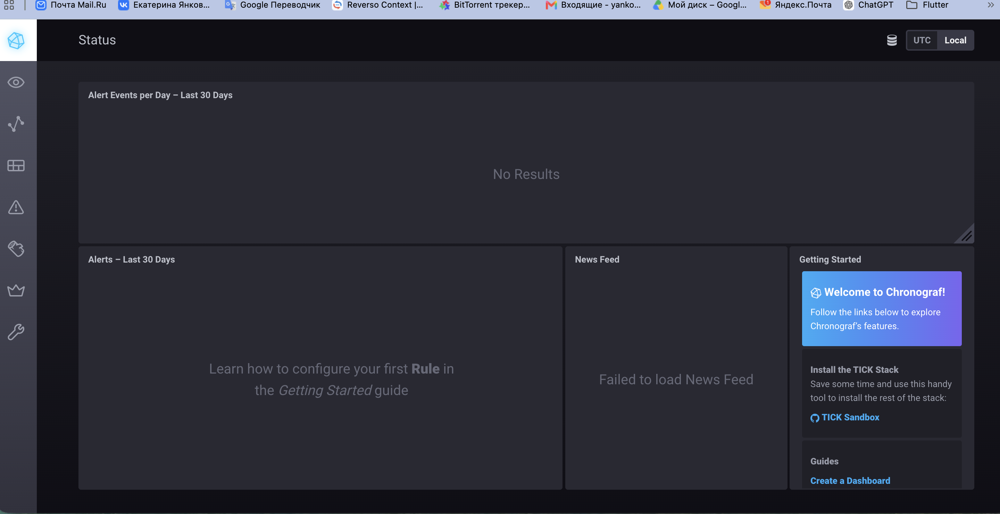
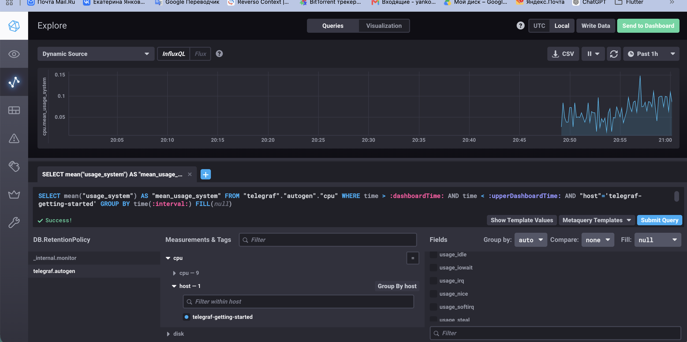
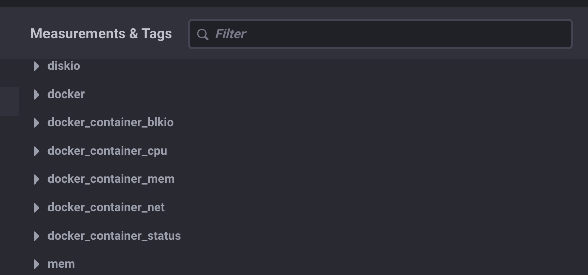

# Домашнее задание «Системы мониторинга» - Юртаева Софья Вячеславовна

[Условия](https://github.com/netology-code/mnt-homeworks/blob/MNT-video/10-monitoring-02-systems/README.md). Выполняются обязательные задания 1–9.

> Стенд запущен на macOS через Docker Desktop. Сбор метрик CPU и Docker подтверждён выводом InfluxDB и скриншотами Chronograf. Задания со звёздочкой не выполнялись.

## 1. Минимальный набор метрик

| Метрика | Для чего нужна |
| --- | --- |
| Загрузка CPU, load average относительно числа ядер | Вычисления нагружают процессор; метрики помогают обнаружить насыщение и очередь исполнения. Load average также включает задачи в непрерываемом ожидании, поэтому его нельзя считать процентом CPU. |
| Доступная RAM, использование swap, OOM | Недостаток памяти приводит к замедлению и аварийному завершению вычислений. |
| Свободные байты и inode на разделе с отчётами | Запись отчётов остановится при исчерпании любого из этих ресурсов. |
| Задержка дисковых операций, IOPS и пропускная способность | Позволяют обнаружить ограничение скорости сохранения отчётов. |
| Число HTTP-запросов в секунду, распределение кодов, задержка p95/p99 | Показывают нагрузку, ошибки и скорость взаимодействия с платформой. |
| Число успешных и неуспешных вычислений, длительность, длина и возраст очереди | HTTP-ответ об отправке задания ещё не означает готовность отчёта. Нужен контроль результата вычислений. |
| Успешность внешней проверки создания и получения отчёта | Проверяет доступность всей пользовательской цепочки, включая сохранение результата. |

Для метрик нужны пороги и оповещения: например, прогноз исчерпания диска, рост очереди, превышение допустимого времени подготовки отчёта.

## 2. Показатели качества для менеджера

Предложу отдельный дашборд с понятными пользователю SLI и целевыми SLO:

- доля отчётов, успешно сформированных и доступных для скачивания;
- доля отчётов, подготовленных за согласованное время, и p95 времени от отправки задания до готовности;
- доступность платформы по внешним проверкам;
- число неуспешных операций и клиентов, затронутых сбоями.

Например, SLO: не менее 99% корректных заданий должны завершаться доступным отчётом за 60 секунд в течение календарного месяца. Значения здесь иллюстративные: их согласуют с продуктом и клиентами. SLI — измеренное значение, SLO — внутренняя цель, SLA — договорные обязательства и последствия нарушения. На дашборде покажу фактический результат, цель и остаток бюджета ошибок. При SLO 99% допускается 1% плохих событий из согласованного набора операций. Ресурсные метрики останутся на техническом дашборде для поиска причин.

## 3. Ошибки приложений без системы сбора логов

Можно внедрить специализированный error tracking, например Sentry: SDK приложения передаёт необработанные исключения и явно зарегистрированные ошибки со stack trace, версией приложения и окружением. Разработчики получают группировку одинаковых ошибок и уведомления. Для ограниченного бюджета можно оценить бесплатный тариф или самостоятельное размещение, учитывая лимиты и расходы на эксплуатацию.

Это не заменяет полное хранение логов: перехваченные исключения нужно отправлять явно, а при sampling и лимитах часть событий может не попасть в систему. Если требуется сохранять все ошибки, необходимо отключить sampling ошибок, подобрать достаточные лимиты и контролировать доставку. Для диагностики сбоев самого процесса нужны также stderr и журналы контейнеров с ротацией. Перед отправкой следует удалять пароли, токены и персональные данные.

## 4. Ошибка расчёта SLA

В знаменатель включены все ответы, а в числитель — только 2xx. Оставшиеся ответы могут относиться к 1xx и 3xx; на практике наиболее вероятны редиректы 3xx. Поэтому отсутствие 4xx/5xx не гарантирует долю 2xx, равную 100%.

Если согласованное определение успешного запроса включает корректные редиректы, показатель за один период равен:

```text
SLI = (число успешных 2xx + число допустимых 3xx) / число учитываемых запросов × 100%
```

Нельзя автоматически считать любой 3xx успехом: цикл редиректов или переход к ошибке не означает успешную операцию. Для пользовательского сценария лучше проверять конечный результат. Информационные ответы 1xx не нужно учитывать как отдельные завершённые запросы. Полученное значение — SLI, который сравнивают с целью SLA 99%.

## 5. Pull и push

| Модель | Плюсы | Минусы |
| --- | --- | --- |
| Pull: сервер опрашивает источники | Централизованное управление частотой опроса; удобно проверять доступность целей; источник не обязан знать адрес хранилища | Нужна доступность источников со стороны сборщика и service discovery; можно пропустить короткоживущую задачу; нагрузку опроса нужно распределять |
| Push: источник отправляет данные | Удобно для краткоживущих задач и источников за NAT; можно передавать события сразу | Нужны очереди, повторы и контроль перегрузки; отсутствие данных не позволяет сразу отличить простой источника от сбоя доставки; источнику нужен адрес приёмника |

Обе модели требуют аутентификации, контроля свежести данных и планирования нагрузки. Надёжность доставки зависит от реализации буферизации, а не только от выбора модели.

## 6. Классификация систем

| Система | Модель и пояснение |
| --- | --- |
| Prometheus | Преимущественно pull: опрашивает HTTP endpoints. Короткоживущие задания могут отправлять метрики в Pushgateway, который Prometheus затем опрашивает. Есть remote write и опциональный приём remote write, но основной способ сбора — pull. |
| TICK | Преимущественно push на участке Telegraf → InfluxDB. При этом inputs Telegraf могут опрашивать источники или принимать события, поэтому весь тракт может быть гибридным. |
| Zabbix | Гибрид: пассивные проверки агента инициирует сервер или proxy; при активных проверках агент получает список проверок и сам отправляет результаты. Есть также trapper и zabbix_sender. |
| VictoriaMetrics | Гибрид: принимает push через remote write и другие протоколы; single-node может опрашивать Prometheus endpoints, либо сбор pull выполняет vmagent с последующей отправкой в хранилище. |
| Nagios | Гибрид: активные проверки инициирует Nagios, результаты пассивных проверок поступают извне. |

Источники: [Prometheus](https://prometheus.io/docs/introduction/overview/), [Telegraf](https://docs.influxdata.com/telegraf/v1/), [Zabbix agent](https://www.zabbix.com/documentation/current/en/manual/appendix/items/activepassive), [VictoriaMetrics](https://docs.victoriametrics.com/victoriametrics/), [Nagios active checks](https://assets.nagios.com/downloads/nagioscore/docs/nagioscore/4/en/activechecks.html), [Nagios passive checks](https://assets.nagios.com/downloads/nagioscore/docs/nagioscore/4/en/passivechecks.html).

## 7. Запуск TICK

Исходный учебный проект: [influxdata/sandbox](https://github.com/influxdata/sandbox). В текущем состоянии его конфигурация уже содержит `inputs.docker`. Для воспроизводимого стенда рядом подготовлена упрощённая конфигурация четырёх компонентов с готовыми образами вместо сборки образов sandbox. Стек запущен и сбор метрик проверен. Исходный sandbox склонирован в `upstream-sandbox`, commit `ce55e5847251a37b6befec4f1edaa0914433f761`. Сам стенд запущен с приложенной адаптированной конфигурацией Compose; каталог исходного проекта исключён из Git через `.gitignore`.

```bash
# Отдельно клонировать исходный проект, как требует задание:
git clone https://github.com/influxdata/sandbox.git upstream-sandbox
# Из каталога с подготовленной конфигурацией:
docker compose config -q
docker compose up -d
docker compose ps
docker compose logs --tail=50 telegraf
```

Открыть http://localhost:8888. Адрес InfluxDB внутри сети Compose: `http://influxdb:8086`, Kapacitor: `http://kapacitor:9092`. Если мастер настройки попросит источник данных, указать эти адреса. Данные хранятся в named volumes.

Веб-интерфейс Chronograf после запуска стека:



## 8. Метрики CPU в Data Explorer

После накопления метрик открыть Data Explorer → Add a query → `telegraf.autogen` → `cpu` → host `telegraf-getting-started` → `usage_system`.

Запрос для среднего значения по всем CPU за последние 15 минут с шагом 10 секунд:

```sql
SELECT mean("usage_system")
FROM "telegraf"."autogen"."cpu"
WHERE time > now() - 15m
  AND "host" = 'telegraf-getting-started'
  AND "cpu" = 'cpu-total'
GROUP BY time(10s) fill(null)
```

Для сравнения можно изменить окно на `1h` и группировку на `time(1m)`. Для отдельных ядер убрать фильтр `cpu-total` и применить `GROUP BY time(10s), "cpu"`. Больший шаг сглаживает короткие пики. `usage_system` показывает долю времени CPU в режиме ядра, а не всю загрузку CPU. В Docker Desktop это метрики окружения контейнера/Linux VM, а не полные метрики macOS.

На скриншоте выбран период Past 1h, поле `usage_system` и host `telegraf-getting-started`; запрос выполнен успешно. Данные доступны с момента запуска стенда. В показанном запросе нет фильтра по тегу `cpu`, поэтому среднее вычисляется по поступающим сериям CPU. Для общего показателя можно использовать приведённый выше фильтр `cpu-total`.



## 9. Метрики Docker

В [telegraf/telegraf.conf](telegraf/telegraf.conf) добавлен плагин:

```toml
[[inputs.docker]]
  endpoint = "unix:///var/run/docker.sock"
  timeout = "5s"
```

В [docker-compose.yml](docker-compose.yml) подключён сокет Docker. Telegraf запускается с UID 0 напрямую через `/usr/bin/telegraf`: штатный entrypoint образа понижает права, поэтому одного `user: "0:0"` недостаточно; `privileged` для этого плагина обычно не нужен. Доступ к Docker API предоставляет широкие права управления Docker, даже при монтировании сокета с `:ro`; стенд предназначен для локальной учебной работы.

После изменения конфигурации:

```bash
docker compose restart telegraf
docker compose logs --tail=50 telegraf
docker compose exec influxdb influx -database telegraf -execute 'SHOW MEASUREMENTS'
```

В Data Explorer обновить список `telegraf.autogen`. Ожидаются `docker`, `docker_container_cpu`, `docker_container_mem`, `docker_container_net`, `docker_container_blkio` и другие доступные для данной версии плагина measurements. Набор зависит от Docker и версии Telegraf.

После пересоздания контейнера Telegraf в базе появились `docker`, `docker_container_blkio`, `docker_container_cpu`, `docker_container_mem`, `docker_container_net` и `docker_container_status`. В логах за проверенный интервал 30 секунд ошибок не было.



Остановка стенда с сохранением данных: `docker compose down`.
